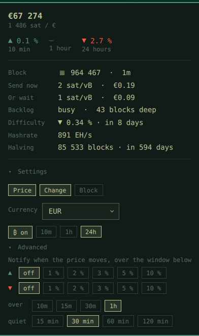

# BTC Watcher

**Bitcoin in the Omarchy bar — including the half the tickers leave out.**

The marketplace has plenty of price pills. This one shows the price too, in any
of 63 currencies, but the reason it exists is the rest: what a transaction
costs *right now in your own money*, how long the queue is, where the chain
stands — and a notification when the price actually moves, so you can stop
looking.



## What it does

**Tells you what sending costs, in your currency.** Fee rates are published in
sat/vB, which is a unit nobody makes decisions in. BTC Watcher converts them
for a typical transaction and shows both ends: `Send now 3 sat/vB · €0.28`
against `Or wait 1 sat/vB · €0.09`. That is the actual question — is it worth
waiting — answered in the only unit that settles it.

**Shows how busy the chain is, in blocks.** `busy · 44 blocks deep` says how
many blocks are ahead of yours. A transaction count cannot say that, because it
depends on what fits in a block.

**Notifies you when the price moves.** Set a threshold per direction — a rise
of 3 %, a fall of 2 % — over a window of 10 to 60 minutes, with a quiet period
so one crossing does not repeat every minute. Every other bar plugin waits to
be looked at. This one speaks up.

**Prices in any currency, with your own history.** All 63 CoinGecko quote
currencies, including XAU, XAG and SATS. Percentage change over 10 minutes, an
hour, or a day — derived from a rolling history kept on disk, not from whatever
single figure an API happens to offer, so every window is available and they
agree with each other.

**Puts what you want in the bar.** Price, its change, the block height — switch
each on or off independently; the pill composes what is left, in order. All of
it from a fold inside the panel, no config file, no terminal.

**Keeps the chain in one glance.** Block height and tip age, fee estimates,
mempool backlog, difficulty with its next retarget, hashrate, and the halving
countdown — one click, no browser tab.

## The panel

```
€67 054
1 491 sat / €

▲ 0.8 %      –           ▼ 2.7 %
10 min       1 hour      24 hours

Block        ▦ 964 458  ·  3m
Send now     3 sat/vB  ·  €0.28
Or wait      1 sat/vB  ·  €0.09
Backlog      busy  ·  44 blocks deep
Difficulty   ▼ 0.48 %  ·  in 8 days
Hashrate     890 EH/s
Halving      85 542 blocks  ·  in 594 days
```

Two of those rows are the point of the whole thing:

**Send now / Or wait** turns the fee rate into what a transaction actually
costs, in your currency, for a typical 140 vB spend. Nobody decides whether to
send by looking at sat/vB — they decide by looking at money, and by seeing what
patience is worth.

**Backlog** counts the queue in blocks rather than transactions. "84 000 tx"
means nothing without knowing what fits in a block; a block holds roughly one
vMB, so the backlog in vMB is close enough to "how many blocks are ahead of
mine" to be the honest way to say it.

## Settings

All of it lives in the panel behind `▸ Settings`, folded away by default —
the panel is opened to read a number, not to configure one.

| | |
| --- | --- |
| **Price · Change · Block** | independent switches; the pill composes what you pick, in that order |
| **Currency** | any of CoinGecko's quote currencies — 63 of them, including XAU, XAG and SATS |
| **₿** | the sign in the bar, on or off |
| **10m · 1h · 24h** | which look-back the percentage in the bar refers to |

Behind a second fold, `▸ Advanced`:

| | |
| --- | --- |
| **▲ / ▼ thresholds** | notify on a rise or fall of 1, 2, 3, 5 or 10 % — `off` disables that direction |
| **over** | the window the move is measured across, capped at an hour |
| **quiet** | how long that direction stays silent after it fired |

The hour cap is deliberate. A slower alert is a news article, not a
notification. The bar can still *display* 24-hour movement — that is a
different job.

Everything is also reachable from the command line, which is where the
settings actually land:

```bash
omarchy bar set io.github.maxmad75.btc-watcher currency SEK
omarchy bar set io.github.maxmad75.btc-watcher display price,change,block
omarchy bar set io.github.maxmad75.btc-watcher notifyDownPercent 3
```

## Install

```bash
omarchy plugin add https://github.com/MaxMad75/omarchy-btc-watcher.git --enable
omarchy bar put io.github.maxmad75.btc-watcher
omarchy restart shell
```

The restart is required, not optional: a newly added plugin is not swapped into
a running shell by the hot reload.

## Remove

```bash
omarchy plugin remove io.github.maxmad75.btc-watcher
omarchy restart shell
```

That takes the widget out of the bar with it. The only thing left behind is the
cache, which holds the price history:

```bash
rm -rf ~/.cache/btc-watcher
```

## Where the numbers come from

| | |
| --- | --- |
| [mempool.space](https://mempool.space) | blocks, fees, difficulty, mempool, hashrate |
| [CoinGecko](https://www.coingecko.com) | price, because mempool.space quotes only seven currencies |

Percentage changes are **not** taken from an upstream field. CoinGecko offers a
ready-made 24-hour change and nothing else, but the bar can be set to 10m, 30m
or 1h — so `bin/btc-watcher-fetch` keeps a rolling 24-hour price history on disk
and derives every window from that one series. They stay consistent with each
other, and the upstream 24-hour figure is used only as a stand-in until the
local history is old enough to answer for itself.

The poll interval is deliberately **independent of the notification window**.
Tying them together would mean a one-hour threshold is only checked once an
hour: the alert would arrive up to an hour late, and a spike that came back
before the next poll would never be seen at all.

Chain data is cached for 45 seconds and the price for 30, so several widgets or
a burst of restarts do not hammer either API.

## How it treats its own inputs

Everything here is either local or comes off the network, and the shell process
it runs inside is long-lived and shared. So:

- The currency is matched against `^[A-Z]{2,10}$` before it goes anywhere. It
  ends up in a request URL *and* in a cache filename, and an unchecked string
  in the second one is a path traversal.
- The cache lives in `~/.cache/btc-watcher/`, created `0700` and verified by
  `lstat`. Reads open with `O_NOFOLLOW|O_NONBLOCK` and decide everything from
  `fstat` on that descriptor — regular file, owned by this user, within 1 MiB,
  parsing to the expected shape — so a symlink cannot be swapped in between the
  check and the read. Writes create their temporary with
  `O_CREAT|O_EXCL|O_NOFOLLOW`, hold that descriptor through write and `fsync`
  without reopening the name, and publish with `os.replace`.
- A whole run has a 15-second budget across all five upstream calls, and each
  response is read with a hard byte cap. The widget enforces its own 256 KiB
  ceiling on what it will accept back.
- Numbers read from `shell.json` fall back to their defaults rather than
  becoming `NaN`. A `NaN` timer interval never fires again, and the widget
  would go quietly stale.

Any of these limits being hit yields the last good reading, or an empty one.
The bar keeps its last value rather than blanking over a failed poll.

## Requirements

Omarchy 4 (Quattro) with `omarchy-shell`, plus `python3` — which a stock install already has (`uwsm`, which launches everything on the
desktop, depends on python itself). Network access to `mempool.space` and
`api.coingecko.com`, and nothing else.

## License

MIT — see [LICENSE](LICENSE).
